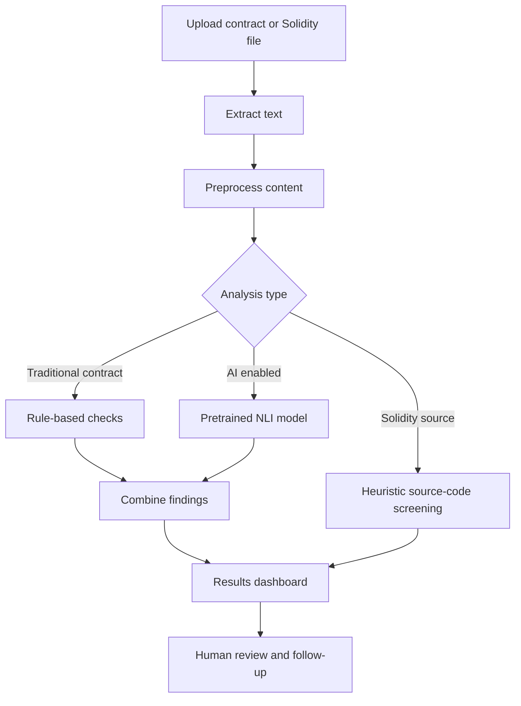

<div align="center">


# ClauseMind AI
### Intelligent Contract Analysis & Solidity Screening

**Understand contracts faster. Surface important clauses. Review potential risks.**

<p>
  
  
  
  
</p>

<p>
  <a href="#features">Features</a> • <a href="#how-it-works">How it works</a> • <a href="#quick-start">Quick start</a> • <a href="#limitations">Limitations</a>
</p>

</div>

---

## Overview

**ClauseMind AI** is a web-based contract intelligence project that helps users inspect traditional agreements and perform an initial heuristic review of Solidity smart-contract source code. It combines text extraction, rule-based checks, and an optional pretrained natural-language-inference (NLI) model to surface clauses and potential issues for further human review.

> **Important:** ClauseMind AI is an educational decision-support tool, not legal advice, a formal security audit, or a substitute for professional review.

## ✨ Features

| Capability | Description |
|---|---|
| 📄 Contract input | Analyse supported text documents and uploaded contract files. |
| 🧠 NLP-assisted review | Optionally use a pretrained NLI model to compare contract text against candidate clause categories. |
| 🔎 Clause discovery | Surface potentially relevant contract sections using patterns and model-assisted classification. |
| ⚠️ Risk indicators | Highlight patterns that may deserve closer attention; scores are heuristic indicators, not probabilities. |
| 🔷 Solidity screening | Basic pattern-based checks against Solidity source code for selected suspicious constructs. |
| 📊 Results dashboard | Review summaries, findings, and analysis history in the web interface. |
| 🗂️ Local history | Store analysis history in a local SQLite database. |

## 🧭 How it works



## 🧰 Technology stack

- **Backend:** Python, Flask
- **NLP model integration:** Hugging Face Transformers and `cross-encoder/nli-MiniLM2-L6-H768`
- **Model runtime:** PyTorch
- **Document extraction:** PDF and DOCX support through dedicated Python libraries; plain text input
- **Frontend:** HTML, CSS, JavaScript
- **Local persistence:** SQLite
- **Smart-contract screening:** Solidity source text with rule-based heuristics

The pretrained model is downloaded when AI-enabled analysis first needs it; model weights are not bundled in this repository. An internet connection may be required for the first model download.

## 🚀 Quick start

### 1. Clone the repository

Replace `YOUR-ORG` and `YOUR-REPO` with your actual repository details.

```bash
git clone https://github.com/YOUR-ORG/YOUR-REPO.git
cd YOUR-REPO
```

### 2. Create a virtual environment

**Windows PowerShell (Python 3.11 recommended):**

```powershell
py -3.11 -m venv .venv
.\.venv\Scripts\Activate.ps1
python -m pip install --upgrade pip
```

**macOS / Linux:**

```bash
python3 -m venv .venv
source .venv/bin/activate
python -m pip install --upgrade pip
```

### 3. Install dependencies

```bash
pip install -r requirements.txt
```

For a CPU-only setup, use `requirements-cpu.txt` if it matches your environment:

```bash
pip install -r requirements-cpu.txt
```

### 4. Start the app

```bash
python app.py
```

Open **http://127.0.0.1:5000** in your browser.

### 5. Run tests

```bash
python -m unittest discover -s tests -v
```

Run the tests locally and report the actual outcome; do not assume they pass just because test files exist.

## 🗃️ Project structure

```text
ClauseMindAI/
├── app.py                    # Flask application and analysis endpoints
├── requirements.txt          # Python dependencies
├── requirements-cpu.txt      # CPU-oriented dependency option
├── README.md                 # Project documentation
├── .gitignore                # Excludes local/generated files
├── assets/
│   └── clausemind-hero.png   # 3D README hero graphic
├── samples/                  # Example contract and Solidity files
└── tests/                    # Automated test files
```

The exact file list may vary by package version. Keep local databases, virtual environments, secrets, and downloaded model caches out of version control.

## 🛡️ Limitations and responsible use

- **Not legal advice:** Important contracts should be reviewed by qualified legal professionals.
- **Not a formal smart-contract audit:** Heuristic checks do not replace static analysers, fuzzers, or expert security review.
- **Possible false positives and false negatives:** A flagged clause may be acceptable in context, and an unflagged clause may still be risky.
- **Model limitations:** The integrated pretrained NLI model is general-purpose, not a custom model trained specifically on legal contracts.
- **Data privacy:** Do not upload confidential contracts unless you have permission and understand how the application stores and processes them. Review deployment settings before public hosting.
- **Performance:** On CPU-only machines, model download and inference may take longer.

## 🧪 Example workflow

1. Start the Flask application.
2. Select a supported contract document or enter text.
3. Run contract analysis.
4. Review the summary and findings.
5. Submit Solidity source for heuristic screening, if needed.
6. Validate important findings manually.

## 🔐 Before publishing

- [ ] Confirm the organisation's repository naming convention.
- [ ] Credit team members and contributors appropriately.
- [ ] Remove API keys, passwords, private documents, local databases, and virtual environments.
- [ ] Confirm sample documents may be redistributed.
- [ ] Run the test suite and record the actual outcome.
- [ ] Add the licence approved by your team or institution.

## 🤝 Contributing

1. Create a branch for your change.
2. Keep commits focused and descriptive.
3. Test changes locally.
4. Open a pull request with a concise explanation and test evidence.

## 📜 Licence

Add the licence approved by your project team or institution before publishing. Do not claim a licence unless the project owners have selected and included it.

## 🙌 Acknowledgements

Update this section with the approved team members, project guide, department, and institution details before the final submission.

<div align="center">

**ClauseMind AI** · Contract intelligence support for clearer first-pass review.

<sub>Made for learning, experimentation, and responsible human-led review.</sub>

</div>
